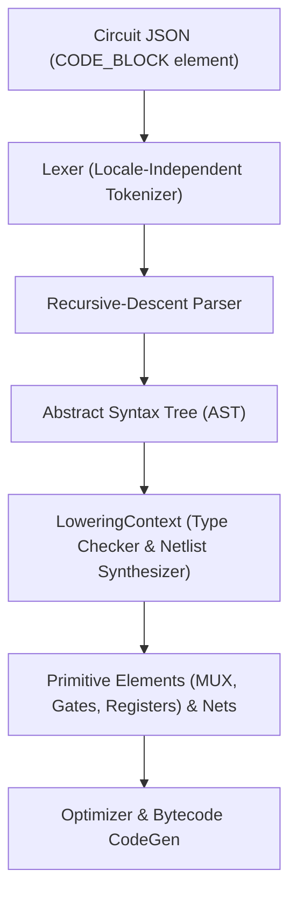

# LogicElements Compiler and Optimizer Guide

This document describes the architecture, optimization pipeline, application programming interfaces (APIs), and data formats for the canonical LogicElements compiler engine.

---

## Table of contents

- [Architectural overview](#architectural-overview)
  - [Compilation pipeline](#compilation-pipeline)
- [Optimization levels](#optimization-levels)
- [Multi-pass optimizer details](#multi-pass-optimizer-details)
  - [1. Constant folding and algebraic simplification](#1-constant-folding-and-algebraic-simplification)
  - [2. Double negation elimination](#2-double-negation-elimination)
  - [3. Hardware inversion folding](#3-hardware-inversion-folding)
  - [4. Common subexpression elimination (CSE)](#4-common-subexpression-elimination-cse)
  - [5. Direct destination coalescing (DDC)](#5-direct-destination-coalescing-ddc)
  - [6. Dead code elimination (DCE)](#6-dead-code-elimination-dce)
- [Canonical Circuit JSON specification](#canonical-circuit-json-specification)
  - [Supported element types](#supported-element-types)
- [Variables in element properties](#variables-in-element-properties)
  - [Declaration](#declaration)
  - [Usage in properties](#usage-in-properties)
  - [Supported expression grammar](#supported-expression-grammar)
  - [Resolution & errors](#resolution--errors)
- [Target Board Profile specification (`.leconfig`)](#target-board-profile-specification-leconfig)
- [C API reference](#c-api-reference)
  - [`le_compile_json_ex`](#le_compile_json_ex)
  - [`le_compile_result_t` structure](#le_compile_result_t-structure)
  - [Memory management](#memory-management)
- [Standalone CLI tool (`le_compile`)](#standalone-cli-tool-le_compile)
  - [Syntax](#syntax)
  - [Options](#options)
- [Binary bytecode specification (`.lebin`)](#binary-bytecode-specification-lebin)
  - [Container Header (20 Bytes)](#container-header-20-bytes)
  - [Chunk Descriptor Header (16 Bytes)](#chunk-descriptor-header-16-bytes)
  - [HEAD Chunk Payload: Circuit Header (`le_header_t`, 44 Bytes)](#head-chunk-payload-circuit-header-le_header_t-44-bytes)
  - [Binary Instruction (8 Bytes)](#binary-instruction-8-bytes)
  - [Virtual operand encoding vs. physical MCU RAM layout](#virtual-operand-encoding-vs-physical-mcu-ram-layout)
  - [Timing descriptor (10 bytes, `timing_count == 1`)](#timing-descriptor-10-bytes-timing_count--1)
  - [Multi-rate execution descriptor (`RATE` Chunk Payload, 8 Bytes)](#multi-rate-execution-descriptor-rate-chunk-payload-8-bytes)
  - [Non-volatile memory requirements descriptor (`NVMD` Chunk Payload)](#non-volatile-memory-requirements-descriptor-nvmd-chunk-payload)
  - [Cryptographic authentication descriptor (`SIGN` Chunk Payload, 64 Bytes)](#cryptographic-authentication-descriptor-sign-chunk-payload-64-bytes)
  - [Structured code blocks (`CODE_BLOCK` synthesis pass)](#structured-code-blocks-code_block-synthesis-pass)
    - [Architecture and lowering pipeline](#architecture-and-lowering-pipeline)
    - [JSON element schema](#json-element-schema)
    - [Embedded C language grammar (EBNF)](#embedded-c-language-grammar-ebnf)
    - [Type system and built-in functions](#type-system-and-built-in-functions)
    - [State registers and persistent variables (`static`)](#state-registers-and-persistent-variables-static)
    - [Compile-time loop unrolling and conditionals](#compile-time-loop-unrolling-and-conditionals)
    - [Inferred latch diagnostics](#inferred-latch-diagnostics)
  - [Fixed-rate scan contract](#fixed-rate-scan-contract)
- [Deterministic timing analysis](#deterministic-timing-analysis)
- [Register aliases](#register-aliases)
  - [Declaring aliases in a circuit](#declaring-aliases-in-a-circuit)
  - [Binary storage](#binary-storage)
  - [Board aliases do not grow the binary](#board-aliases-do-not-grow-the-binary)
  - [Runtime API](#runtime-api)
  - [Terminal command](#terminal-command)
- [Digital signal processing (DSP) and real-time filtering](#digital-signal-processing-dsp-and-real-time-filtering)
  - [Zero-heap static memory architecture](#zero-heap-static-memory-architecture)
  - [DSP opcode specification](#dsp-opcode-specification)
  - [Numerical stability safeguards](#numerical-stability-safeguards)
  - [Circuit JSON schema for DSP elements](#circuit-json-schema-for-dsp-elements)
  - [Board capability and workspace validation](#board-capability-and-workspace-validation)
- [Related guides](#related-guides)

---

## Architectural overview

The LogicElements compiler translates high-level graphical circuit schematics or JSON circuit representations into compact, deterministic bytecode (`.lebin`) targeted at embedded microcontrollers.

The compilation engine is implemented in standard C++17 (`src/compiler/src/le_compiler_core.cpp` and `le_optimizer.cpp`) and exposes:
- A pure **C API** (`include/le_compiler.h`) for integration with runtime loaders, external applications, and shared libraries.
- A **Python SDK** (`tools/compiler/le_compiler.py`) using `ctypes` for scripting, board capability profiling, and automated testing.
- A standalone **CLI executable** (`le_compile`) for automated build pipelines and firmware embedding.
- Direct static library linking (`le_compiler_static.lib`) into desktop applications such as **LogicElementsUI**.

### Compilation pipeline

```
┌────────────────────────────────────────────────────────┐
│               Input Circuit JSON                       │
│  - Elements: Digital I/O, Gates, Math, Regs, Custom    │
│  - Nets: Port-to-port connections                      │
│  - Target Board Profile JSON (.leconfig)               │
└───────────────────────────┬────────────────────────────┘
                            │
                            ▼
┌────────────────────────────────────────────────────────┐
│            1. Parsing and Validation                   │
│  - Validate circuit structure and net connectivity     │
│  - Verify board limits & unified RAM workspace bytes   │
│    (DIN, DOUT, AIN, Coils, Floats, Ints, Complex)      │
│  - Verify feature support (Protection relays, Buses)   │
│  - Resolve symbolic pin aliases (%IN0, %OUT0)          │
└───────────────────────────┬────────────────────────────┘
                            │
                            ▼
┌────────────────────────────────────────────────────────┐
│            2. Intermediate Representation (IR)         │
│  - Construct dependency graph with producer/consumer   │
│  - Track hardware side effects (DOUT, flash, latches)  │
└───────────────────────────┬────────────────────────────┘
                            │
                            ▼
┌────────────────────────────────────────────────────────┐
│            3. Fixed-Point Multi-Pass Optimizer         │
│  - Run iterative pass loop until convergence (-O1..-Os)│
│  - Constant Folding & Algebraic Simplification         │
│  - Double Negation Elimination                         │
│  - Hardware Inversion Folding                          │
│  - Common Subexpression Elimination (CSE)              │
│  - Direct Destination Coalescing (DDC)                 │
│  - Dead Code Elimination (DCE)                         │
└───────────────────────────┬────────────────────────────┘
                            │
                            ▼
┌────────────────────────────────────────────────────────┐
│            4. Liveness Analysis & Register Allocation  │
│  - Topological sort of optimized dependency graph      │
│  - Track live ranges for intermediate values           │
│  - Greedy register reuse for temporary bools/floats    │
└───────────────────────────┬────────────────────────────┘
                            │
                            ▼
┌────────────────────────────────────────────────────────┐
│            5. Code Generation & Formatting             │
│  - Pack 20-byte LEB2 container header (LE_BIN_MAGIC)   │
│  - Emit self-describing chunks (HEAD, INST, TIME, etc.)│
│  - Emit 8-byte binary instructions (.lebin)            │
│  - Optional multi-rate domain partitioning (RATE)      │
│  - Optional Ed25519 cryptographic signing (SIGN)       │
│  - Generate human-readable disassembly text            │
│  - Generate flash-embeddable C static array header     │
└────────────────────────────────────────────────────────┘
```

---

## Optimization levels

The compiler supports four standard optimization levels configured via `le_opt_level_t`:

| Level | Name | Description | Passes applied |
| :--- | :--- | :--- | :--- |
| `-O0` | None | Preserves 1:1 schematic node-to-instruction mapping for interactive debugging. | None |
| `-O1` | Basic | Performs safe structural cleanups without modifying gate semantics. | Direct Destination Coalescing, Dead Code Elimination |
| `-O2` | Full | Default production optimization. Maximizes throughput and minimizes size. | Constant Folding, Inversion Folding, Double Negation, CSE, Destination Coalescing, Dead Code Elimination |
| `-Os` | Size | Aggressive size optimization targeting constrained microcontroller flash slots. | All `-O2` passes executed with maximum pass limit (10 iterations) |

To initialize compiler options programmatically:

```c
#include "le_compiler_options.h"

// Default full optimization (-O2):
le_compiler_options_t options = le_compiler_options_init(LE_OPT_FULL);

// Debug mode (-O0):
le_compiler_options_t dbg_options = le_compiler_options_init(LE_OPT_NONE);

// Multi-rate execution domains:
options.enable_multi_rate = 1;
options.rate_med_div = 48;   // Medium domain executes at 1/48 rate
options.rate_slow_div = 480; // Slow domain executes at 1/480 rate
```

---

## Multi-pass optimizer details

The multi-pass optimizer executes an iterative fixed-point loop. When any pass alters the IR graph, the loop re-executes up to the configured `max_pass_iterations` (default: 5 for `-O2`, 10 for `-Os`).

### 1. Constant folding and algebraic simplification

Evaluates operations whose inputs are statically known at compile time, eliminating runtime CPU cycles.

- **Boolean logic**:
  - `AND(x, FALSE)` $\to$ `FALSE`
  - `AND(x, TRUE)` $\to$ `x`
  - `OR(x, TRUE)` $\to$ `TRUE`
  - `OR(x, FALSE)` $\to$ `x`
  - `XOR(x, FALSE)` $\to$ `x`
  - `XOR(x, TRUE)` $\to$ `NOT(x)`
- **Float arithmetic**:
  - `ADD_F(x, 0.0f)` $\to$ `x`
  - `SUB_F(x, 0.0f)` $\to$ `x`
  - `MUL_F(x, 1.0f)` $\to$ `x`
  - `MUL_F(x, 0.0f)` $\to$ `0.0f`
  - `DIV_F(x, 1.0f)` $\to$ `x`
  - Statically evaluates two constant inputs: `ADD_F(2.0, 3.0)` $\to$ `5.0`.

### 2. Double negation elimination

Detects consecutive NOT gates in a data path and collapses them to a direct connection:

```
[IN0] ──► [NOT 1] ──► [NOT 2] ──► [OUT0]
               Collapsed to:
[IN0] ──────────────────────────► [OUT0]
```

### 3. Hardware inversion folding

Microcontroller VM instructions contain operand modifier flags (`LE_MOD_INVERT_A` = `0x01`, `LE_MOD_INVERT_B` = `0x02`). When a NOT gate feeds into a compatible gate (AND, OR, XOR), the optimizer folds the inversion into the consumer's modifier byte and deletes the standalone NOT instruction:

```
[IN0] ──► [NOT] ──► (in_a) [AND] ──► [OUT0]
[IN1] ────────────► (in_b)
               Folded to:
[IN0] ────────────► (in_a) [AND: mod=LE_MOD_INVERT_A] ──► [OUT0]
[IN1] ────────────► (in_b)
```

> [!NOTE]
> Hardware inversion folding reduces instruction count by 1 and eliminates 1 temporary boolean register.

### 4. Common subexpression elimination (CSE)

Identifies duplicate computations receiving identical inputs within the same execution cycle:

```
[IN0] ──┬──► [AND 1] ──► [DOUT 0]
[IN1] ──┼──►
        │
        ├──► [AND 2] ──► [DOUT 1]
        └──► (Identical inputs)
```

The optimizer detects that `AND 1` and `AND 2` perform identical operations on commutative inputs, removes `AND 2`, and rewires `DOUT 1` to read directly from `AND 1`.

### 5. Direct destination coalescing (DDC)

When a gate's output drives a digital output (`%Q`) or user register (`%M`, `%R`), unoptimized compilation creates an intermediate temporary register and a trailing `MOVE` instruction:

```
Unoptimized (-O0):
  OP_AND   DIN[0], DIN[1]  -> T_BOOL[0]
  OP_MOVE  T_BOOL[0]       -> DOUT[0]

Coalesced (-O2):
  OP_AND   DIN[0], DIN[1]  -> DOUT[0]
```

Direct Destination Coalescing eliminates the redundant `OP_MOVE` instruction and frees the temporary register.

### 6. Dead code elimination (DCE)

Performs reverse reachability analysis rooted at all hardware side-effect nodes:
- Physical outputs (`DIGITALOUTPUT`, `DOUT`)
- State registers (`BOOLREGISTER`, `FLOATREGISTER`, `INTREGISTER`)
- Stateful elements (`TON`, `TOF`, `TP`, `CTU`, `CTD`, `CTUD`, `LATCH`, `SR`, `RS`)
- Custom peripheral drivers (`LE_CUSTOM`) — emitted as an `LE_OP_BLOCK` with a custom function id
- Protection relays and serial bus elements (`OVERCURRENT`, `DIFF_87`, `I2C`, `SPI`)

Any pure logic gate whose output is never consumed and cannot affect circuit state is pruned from the emitted bytecode.

---

## Canonical Circuit JSON specification

The compiler ingests standard circuit JSON containing `name`, `elements`, and `nets`.

```json
{
  "name": "MotorControlCircuit",
  "elements": [
    { "name": "START_PB", "type": "DIGITALINPUT", "address": "%I0" },
    { "name": "STOP_PB",  "type": "DIGITALINPUT", "address": "%I1" },
    { "name": "RUN_LATCH", "type": "LATCH", "dominant": "Reset Dominant" },
    { "name": "MOTOR_CONTACTOR", "type": "DIGITALOUTPUT", "address": "%Q0", "safe_state": 0 }
  ],
  "nets": [
    {
      "output": { "name": "START_PB", "port": "out" },
      "inputs": [ { "name": "RUN_LATCH", "port": "s" } ]
    },
    {
      "output": { "name": "STOP_PB", "port": "out" },
      "inputs": [ { "name": "RUN_LATCH", "port": "r" } ]
    },
    {
      "output": { "name": "RUN_LATCH", "port": "q" },
      "inputs": [ { "name": "MOTOR_CONTACTOR", "port": "in" } ]
    }
  ]
}
```

### Supported element types

| Type Name | Category | Inputs | Outputs | Required properties |
| :--- | :--- | :--- | :--- | :--- |
| `DIGITALINPUT` | I/O | None | `out` | `address` (`%IN0..%INn`) or mapped alias |
| `DIGITALOUTPUT` | I/O | `in` | None | `address` (`%OUT0..%OUTn`) or mapped alias, optional `safe_state` |
| `ANALOGINPUT` | I/O | None | `val` / `out` | `channel`, optional `raw_min`, `raw_max`, `scale_min`, `scale_max` |
| `BOOLREGISTER` | Storage | `in` | `out` | `address` (`%B0..%Bn`) or mapped alias |
| `FLOATREGISTER` | Storage | `in` | `out` | `address` (`%F0..%Fn`) or mapped alias, optional `units` |
| `INTREGISTER` | Storage | `in` | `out` | `address` (`%I0..%In`) or mapped alias, optional `value` |
| `COMPLEXREGISTER` | Storage | `in` | `out` | `address` (`%C0..%Cn`) or mapped alias |
| `CONSTANT` | Math | None | `out` | `dataType` (`Boolean`/`Float`/`Integer`/`Complex`), `value` |
| `AND`, `OR`, `XOR`, `NAND`, `NOR` | Logic | `a`, `b` (or fan-in `a`..`z`) | `out` | None |
| `NOT` | Logic | `in` | `out` | None |
| `MUX` | Logic | `sel`, `in0`, `in1` | `out` | None |
| `RTRIG`, `FTRIG` | Edge | `clk` | `q` | None |
| `LATCH`, `SR`, `RS` | Memory | `s`, `r` | `q` | `dominant` (`"Reset Dominant"` or `"Set Dominant"`) |
| `TON`, `TOF`, `TP` | Timer | `in` | `q` | `preset_ms` |
| `CTU`, `CTD`, `CTUD` | Counter | `cu`, `cd`, `r` | `q` | `preset` |
| `ADD`, `SUB`, `MUL`, `DIV` | Float Math | `a`, `b` | `out` | None |
| `ABS`, `NEG`, `MIN`, `MAX`, `CLAMP` | Float Math | `a`, `b` | `out` | None (or `min`, `max` for clamp) |
| `CADD`, `CSUB`, `CMUL`, `CDIV` | Complex Math | `a`, `b` | `out` | None |
| `CMP_GT`, `CMP_LT`, `CMP_GE`, `CMP_LE`, `CMP_EQ`, `CMP_NE` | Compare | `a`, `b` | `out` | None |
| `LPF`, `BIQUAD`, `MOVING_AVG`, `RATE_LIMITER` | DSP Filter | Signal inputs | `out` | Filter-specific tuning (`alpha`, `window_size`, etc.) |
| `DEADBAND`, `WASHOUT`, `PEAK_DETECTOR`, `RMS` | DSP Filter | Signal inputs | `out` | Filter-specific tuning (`threshold`, `decay_rate`, etc.) |
| `MEDIAN`, `DERIVATIVE`, `ZERO_CROSSING`, `LUT_1D` | DSP / Signal | Signal inputs | `out` | `window_size`, `alpha`, `num_points`, etc. |
| `TOTALIZER`, `MIN_MAX_HOLD`, `PID` | Control / DSP | Signal inputs | `out` | Element tuning (`time_base_sec`, `kp`, `ki`, `kd`, etc.) |
| `PHASOR_1P`, `PHASOR_3P`, `FREQ_EST` | Protection / Phasor | Waveform samples | Phasors / Frequency | `samples_per_cycle`, `nominal_freq_hz`, etc. |
| `OVERCURRENT_51`, `DIST_21`, `DIFF_87`, `PHASE_COMP` | Protection Relay | Phasors / Enable | Trip / Comp | Relay settings (`pickup`, `time_dial`, `reach`, `o87p`, etc.) |
| `RECT2POLAR`, `POLAR2RECT`, `RECT2COMPLEX`, `COMPLEX2RECT` | Conversion | Inputs | Outputs | None |
| `I2C`, `SPI` | Serial Bus | Clock / Data | Out | `addr`, `cs_pin`, `poll_rate_ms`, etc. |
| `LE_CUSTOM` | Board Ext | Dynamic | Dynamic | `custom_type`, `function_id` |

---

## Variables in element properties

Circuit schematics may declare a top-level `variables` object and reference
those names from any numeric element property using `%VARNAME%` (or a bare name
inside an arithmetic string). This lets a designer retune a whole schematic from
one place instead of editing every element.

### Declaration

```json
{
  "name": "ZoneRelays",
  "variables": {
    "Z_Line": 5.0,
    "Z2": "Z_Line * 1.20",
    "pu": 0.90
  },
  "elements": [
    { "name": "D21", "type": "DIST_21", "reach": "%Z2%", "prefault_v_threshold": "%pu%" }
  ],
  "nets": []
}
```

A variable is either:

- **Direct scalar** — a JSON number (`"Z_Line": 5.0`).
- **Indirect / derived** — a JSON string expression over other variables and/or
  literals (`"Z2": "Z_Line * 1.20"`). Indirect variables may reference each other
  (`"A": "B * 2", "B": "10"`).

### Usage in properties

Any numeric property (timer `preset_ms`, `reach`, `alpha`, `kp`, `o87p`,
`time_dial`, `input_count`, …) accepts:

- a literal number, unchanged;
- `"%VAR%"` — resolves to the variable's numeric value;
- a string expression mixing variables/literals, e.g. `"reach": "Z2 * 0.8"`.

### Supported expression grammar

Arithmetic operators `+ - * /`, parentheses, unary `+`/`-`, and a set of
**trig + math functions** (case-insensitive; unary or two-argument):

| Class | Functions |
| :--- | :--- |
| Trig    | `sin`, `cos`, `tan`, `asin`, `acos`, `atan` (1- or 2-arg `atan2`) |
| Exp/log | `exp`, `ln`/`log`, `log10`, `log2`, `pow(a,b)` |
| Roots   | `sqrt`, `cbrt` |
| Round   | `abs`, `floor`, `ceil`, `round`, `min(a,b)`, `max(a,b)`, `fmod(a,b)` |

Variables may be bare (`Z_Line`) or wrapped in `%…%`. Examples:
`"imp": "(Z_Line + Z2) / 2.0"`, `"mag": "sqrt(Z2 * Z2 + Z_Line * Z_Line)"`,
`"k": "max(0.5, sin(theta) * 2)"`.

### Resolution & errors

Variables are resolved **topologically** (an indirect variable's dependencies are
evaluated first) and memoized, so a variable used in many properties is
evaluated once. A **circular** reference (`A -> B -> A`) or an **undefined**
reference produces a compile error:

```
Variable Error: undefined variable reference: Missing
Variable Error: circular variable reference: B
```

Direct scalar expressions, indirect (variable-on-variable) definitions, cycle
detection, and undefined-variable rejection are all covered by the compiler test
suite (`test_variables`, `test_variable_errors`).

---

## Target Board Profile specification (`.leconfig`)

Target board profiles define physical microcontroller limits and configuration:

```json
{
  "device": {
    "name": "STM32F401RE-Nucleo",
    "firmware_version": "1.0",
    "protocol_version": 1
  },
  "limits": {
    "digital_inputs": 16,
    "digital_outputs": 16,
    "analog_inputs": 16,
    "analog_outputs": 4,
    "workspace_bytes": 2048,
    "config_slots": 3,
    "slot_size_bytes": 2048,
    "ns_per_abstract_cycle": 600,
    "nvram_total_bytes": 16384,
    "nvram_block_size": 4096,
    "nvram_page_size": 256
  },
  "features": {
    "protection": true,
    "complex": true,
    "analog": true,
    "dsp": true,
    "serial_bus": true
  },
  "pin_map": {
    "inputs": {
      "%IN0": { "alias": "USER_BUTTON", "pin": "PC13", "desc": "Onboard User Pushbutton" },
      "%IN1": { "alias": "LIMIT_SW_FWD", "pin": "PA0", "desc": "Forward Limit Switch" }
    },
    "outputs": {
      "%OUT0": { "alias": "USER_LED", "pin": "PA5", "desc": "Green Onboard LED" },
      "%OUT1": { "alias": "MOTOR_FWD", "pin": "PB0", "desc": "Motor Forward Relay" }
    }
  },
  "custom_nodes": [
    {
      "type_id": "STM32_PWM_Gen",
      "display_name": "PWM Generator",
      "category": "STM32 Peripherals",
      "function_id": 1,
      "inputs": [ { "name": "Enable", "type": "bool", "default": false }, { "name": "DutyCycle", "type": "float", "default": 50.0 } ],
      "outputs": [ { "name": "Active", "type": "bool" } ]
    }
  ]
}
```

---

## C API reference

Header: [`src/compiler/include/le_compiler.h`](file:///c:/Users/tanne/OneDrive/Documents/GitHub/LogicElements/src/compiler/include/le_compiler.h)

### `le_compile_json_ex`

Compiles a circuit JSON string with explicit optimization options against an optional board profile.

```c
int le_compile_json_ex(
    const char*                  circuit_json,
    const char*                  board_profile_json,
    const le_compiler_options_t* options,
    le_compile_result_t*         out_result
);
```

**Parameters**:
- `circuit_json` (*const char\**): Null-terminated JSON string defining the circuit.
- `board_profile_json` (*const char\**): Optional null-terminated JSON string defining the board profile. Pass `NULL` to compile without board limit constraints.
- `options` (*const le_compiler_options_t\**): Pointer to configuration options. Pass `NULL` to default to `-O2`.
- `out_result` (*le_compile_result_t\**): Destination struct populated with compilation output.

**Returns**:
- `0` on success. Non-zero if compilation encountered an error.

### `le_compile_result_t` structure

```c
typedef struct {
    int         success;                  /* 1 = succeeded, 0 = failed */
    char*       error_message;            /* Error message string (or NULL) */
    char*       warnings;                 /* Warning messages (or NULL) */
    uint8_t*    binary_data;              /* Pointer to raw .lebin binary */
    size_t      binary_size;              /* Byte length of binary_data */
    char*       c_header_code;            /* C static array header source code */
    char*       disassembly_text;         /* Formatted assembly listing */
    char*       json_circuit;             /* Normalized circuit JSON */
    int         instruction_count;        /* Emitted instruction count */
    int         din_count;                /* Digital inputs used (%IN) */
    int         dout_count;               /* Digital outputs used (%OUT) */
    int         ain_count;                /* Analog inputs used (%AIN) */
    int         aout_count;               /* Analog outputs used (%AOUT) */
    int         bool_reg_count;           /* Total boolean registers allocated (%B) */
    int         float_count;              /* Total float registers allocated (%F) */
    int         complex_count;            /* Total complex registers allocated (%C) */
    int         int_count;                /* Total integer registers allocated (%I) */
    int         timer_count;              /* Timers used */
    int         counter_count;            /* Counters used */
    int         alias_count;              /* Register aliases declared */
    uint32_t    crc32;                    /* IEEE 802.3 CRC32 checksum */
    int         user_bool_count;          /* Explicit user %B registers */
    int         temp_bool_count;          /* Peak temporary scratchpad registers */
    int         user_float_count;         /* Explicit user %F registers */
    int         temp_float_count;         /* Peak temporary float registers */
    int         user_complex_count;       /* Explicit user %C registers */
    int         temp_complex_count;       /* Peak temporary complex registers */
    int         user_int_count;           /* Explicit user %I registers */
    int         temp_int_count;           /* Peak temporary int registers */
    int         eliminated_instructions;  /* Instructions pruned by optimizer */
    int         eliminated_registers;     /* Registers saved by optimizer */
    uint32_t    abstract_cycles;          /* Worst-case compiler abstract cost */
    double      estimated_exec_us;        /* Estimated scan execution time (us) */
} le_compile_result_t;
```

### Memory management

All pointers returned in `le_compile_result_t` are dynamically allocated. You **must** release them using `le_compile_result_free`:

```c
le_compile_result_t result;
memset(&result, 0, sizeof(result));

int rc = le_compile_json_ex(circuit_json, board_json, &options, &result);
if (rc == 0 && result.success) {
    // Process result.binary_data, result.c_header_code, etc.
}

le_compile_result_free(&result);
```

---

## Standalone CLI tool (`le_compile`)

The `le_compile` executable provides complete command-line access to the compiler.

### Syntax

```bash
le_compile <circuit.json> [options]
```

### Options

| Option | Description |
| :--- | :--- |
| `-o, --output <file>` | Destination path for the `.lebin` binary payload. |
| `-b, --board <file>` | Target `.leconfig` board profile for limit validation and pin aliases. |
| `-c, --header <file>` | Destination path for an embeddable C static header file. |
| `-d, --disasm <file>` | Destination path for a human-readable assembly disassembly listing. |
| `-O0` | Disable all optimizations (1:1 schematic debug mode). |
| `-O1` | Enable basic optimizations (DDC, DCE). |
| `-O2` | Enable full optimizations (Default). |
| `-Os` | Enable aggressive size optimizations. |
| `-m, --multi-rate` | Partition bytecode into fast, medium, and slow execution domains. |
| `-t, --target <version>` | Target container format version (Default: `13`). |
| `--med-div <N>` | Medium rate scan prescaler divisor (Default: 48). |
| `--slow-div <N>` | Slow rate scan prescaler divisor (Default: 480). |
| `--sign <key_file>` | Cryptographically sign output container with a 64-byte Ed25519 secret key. |
| `--keygen <name>` | Generate an Ed25519 keypair and write `<name>.pk` and `<name>.sk`. |
| `--no-dce` | Disable Dead Code Elimination pass. |
| `--no-fold` | Disable Constant Folding pass. |
| `--no-cse` | Disable Common Subexpression Elimination pass. |
| `--no-inversion` | Disable Hardware Inversion Folding pass. |
| `--no-direct-dest` | Disable Direct Destination Coalescing pass. |
| `--stats` | Display optimization metrics and memory savings in console. |
| `-v, --version` | Display compiler version information. |
| `-h, --help` | Display command usage and help. |

---

## Binary bytecode specification (`.lebin`)

LogicElements standardizes exclusively on the **LEB2 chunked container** format (`LE_BIN_MAGIC = 0x4C454232`, ASCII `"LEB2"`, version `13`). The binary begins with a 20-byte container header followed by self-describing, independent chunks (`HEAD`, `INST`, `BLCK`, `STAT`, `SIMG`, `ALIS`, `TIME`, `RATE`, `NVMD`, `SIGN`). Each chunk carries its own 16-byte header and IEEE 802.3 CRC32 checksum, providing zero-copy execution, backward-compatible extension, cryptographic signing, and multi-domain rate prescaling.

### Container Header (20 Bytes)

| Offset | Field | Type | Description |
| :--- | :--- | :--- | :--- |
| `0x00` | `magic` | `uint32_t` | Magic identifier: `'LEB2'` (`0x4C454232`, little-endian). |
| `0x04` | `version` | `uint16_t` | Container format version (Current: `13`). |
| `0x06` | `flags` | `uint16_t` | Execution flags (`0x0001` = Autostart VM). |
| `0x08` | `total_size` | `uint32_t` | Total binary file size in bytes including container header. |
| `0x0C` | `chunk_count` | `uint16_t` | Number of chunks stored in this container file. |
| `0x0E` | `reserved` | `uint16_t` | Reserved / padding for 32-bit alignment (`0`). |
| `0x10` | `header_crc32` | `uint32_t` | IEEE 802.3 CRC32 of container header (computed with CRC field zeroed). |

### Chunk Descriptor Header (16 Bytes)

Every chunk in the container begins with a standard 16-byte header:

| Offset | Field | Type | Description |
| :--- | :--- | :--- | :--- |
| `0x00` | `tag` | `uint32_t` | FourCC chunk tag: `'HEAD'`, `'INST'`, `'BLCK'`, `'STAT'`, `'SIMG'`, `'ALIS'`, `'TIME'`, `'RATE'`, `'NVMD'`, `'SIGN'`. |
| `0x04` | `length` | `uint32_t` | Payload length in bytes (excluding this 16-byte chunk header). |
| `0x08` | `crc32` | `uint32_t` | IEEE 802.3 CRC32 checksum of this chunk's payload bytes. |
| `0x0C` | `flags` | `uint32_t` | Chunk attributes / flags (`0` for standard chunk). |

### HEAD Chunk Payload: Circuit Header (`le_header_t`, 44 Bytes)

The `'HEAD'` chunk contains circuit sizing and register allocation metadata:

| Offset | Field | Type | Description |
| :--- | :--- | :--- | :--- |
| `0x00` | `magic` | `uint32_t` | Magic identifier: `'LEB2'` (`0x4C454232`). |
| `0x04` | `version` | `uint16_t` | Format version (`13`). |
| `0x06` | `flags` | `uint16_t` | Execution flags (`0x0001` = Autostart VM). |
| `0x08` | `instruction_count` | `uint16_t` | Total instructions in payload ($N$). |
| `0x0A` | `digital_in_count` | `uint16_t` | Number of digital inputs allocated (%IN). |
| `0x0C` | `digital_out_count` | `uint16_t` | Number of digital outputs allocated (%OUT). |
| `0x0E` | `bool_reg_count` | `uint16_t` | Total internal boolean registers allocated (%B). |
| `0x10` | `float_reg_count` | `uint16_t` | Total float registers allocated (%F). |
| `0x12` | `complex_reg_count` | `uint16_t` | Total complex registers allocated (%C). |
| `0x14` | `int_reg_count` | `uint16_t` | Total int registers allocated (%I). |
| `0x16` | `analog_in_count` | `uint16_t` | Total analog input channels allocated (%AIN). |
| `0x18` | `block_count` | `uint16_t` | Number of variable-arity block descriptors. |
| `0x1A` | `state_desc_count` | `uint16_t` | Number of state-group (directive) records. |
| `0x1C` | `state_img_len` | `uint32_t` | Bytes of the preconfigured state image. |
| `0x20` | `alias_count` | `uint16_t` | Number of user-declared register aliases. |
| `0x22` | `timing_count` | `uint16_t` | `1` when timing information is present. |
| `0x24` | `reserved` | `uint16_t` | Reserved padding to 44 bytes. |
| `0x26` | `crc32` | `uint32_t` | Backward-compatibility CRC32. |

> State element instances are **not** enumerated per type in the header. The
> compiler bakes each block's state (defaults + properties) as concrete bytes
> into the `'SIMG'` chunk; the `'STAT'` chunk records `{ kind, count, size }`
> per kind group so the loader can compute each group's byte offset, and
> `state_img_len` is the bound for the platform's state workspace.

### Binary Instruction (8 Bytes)

```
Byte 0:    [ Opcode (uint8_t) ]
Byte 1:    [ Modifier (uint8_t) ] (Bit 0: Invert A, Bit 1: Invert B, or Ext Function ID)
Bytes 2-3: [ Input Address A (uint16_t, Little-Endian) ]
Bytes 4-5: [ Input Address B (uint16_t, Little-Endian) ]
Bytes 6-7: [ Output Address  (uint16_t, Little-Endian) ]
```

### Virtual operand encoding vs. physical MCU RAM layout

> [!IMPORTANT]
> **Virtual handles, not physical MCU memory addresses**:
> Unlike microcontroller peripherals which are hardware memory-mapped (e.g. ARM Cortex-M peripheral registers at `0x40000000`), the 16-bit "addresses" in LogicElements instructions are **compact virtual operand tags**.
>
> In the physical microcontroller RAM, there are **no hardcoded address windows or wasted static arrays**. At load time, the runtime allocates a single, contiguously packed memory buffer sized *only* to what the circuit actually requires.

#### 1. Virtual instruction operand encoding (16-Bit)

Inside an 8-byte instruction, the high 4 bits (`0xF000`) identify the register family/type, and the low 12 bits (`0x0FFF`) identify the index (with extended regions supporting up to 13 bits):

| Register Family | Virtual Range | Tag Mnemonic | Index Width & Architectural Capacity |
| :--- | :--- | :--- | :--- |
| Digital Inputs | `0x0000 - 0x0FFF` | `%IN[i]` | 12-bit index (up to 4,096 inputs) |
| Digital Outputs | `0x1000 - 0x1FFF` | `%OUT[i]` | 12-bit index (up to 4,096 outputs) |
| Analog Inputs | `0x2000 - 0x2FFF` | `%AIN[i]` | 12-bit index (up to 4,096 ADC channels) |
| Analog Outputs | `0x3000 - 0x3FFF` | `%AOUT[i]` | 12-bit index (up to 4,096 DAC channels) |
| Boolean Registers | `0x4000 - 0x5FFF` | `%B[i]` / `T_B[i]` | 13-bit index (up to 8,192 bit-packed booleans) |
| Integer Registers | `0x6000 - 0x7FFF` | `%I[i]` / `T_I[i]` | 13-bit index (up to 8,192 32-bit integers) |
| Float Registers | `0x8000 - 0x9FFF` | `%F[i]` / `T_F[i]` | 13-bit index (up to 8,192 32-bit floats) |
| Complex Registers | `0xA000 - 0xAFFF` | `%C[i]` / `T_C[i]` | 12-bit index (up to 4,096 complex phasor pairs) |
| Reserved Primitives | `0xB000 - 0xBFFF` | — | Reserved for future primitives (e.g. `%L` int64) |
| Immediate Constants | `0xC000 - 0xCFFF` | `FALSE`, `TRUE`, `0.0f`, `0+0j` | Predefined immediate literals (`LE_CONST_*`) |
| Reserved Structs | `0xD000 - 0xDFFF` | — | Reserved for future structs (e.g. `%D` double64) |
| System Variables | `0xE000 - 0xEFFF` | `%SYS[i]` | Reserved for system & diagnostic variables |
| Reserved | `0xF000 - 0xFFFE` | — | Reserved |
| Unused Operand | `0xFFFF` | `—` | Fast unconnected/default false sentinel (`LE_ADDR_UNUSED`) |

> [!NOTE]
> **Removal of Dedicated Timer/Counter Address Regions**:
> In binary format v12, dedicated virtual address spaces for Timers and Counters were eliminated. Timers (`TON`, `TOF`, `TP`) and Counters (`CTU`, `CTD`, `CTUD`) are stateful blocks instantiated in the unified state image. Their instance index is held in the instruction's `modifier` byte, and their boolean outputs (`Q`) write directly to standard boolean destinations (`%B` temporary or user registers, or coalesced `%OUT` pins).

> The legacy `%I` (digital input) / `%Q` / `%M` / `%R` spellings were renamed to
> `%IN` / `%OUT` / `%B` / `%F` respectively in binary version `6`. Existing
> element JSON using the old spellings is still accepted by the compiler, and
> `DIN[i]` / `DOUT[i]` / `BOOL[i]` / `FLOAT[i]` / `INT[i]` / `AIN[i]` / `AOUT[i]` remain
> valid synonyms in alias targets.

#### 2. Physical MCU RAM layout: dynamically packed workspace

On the physical device, all data resides in one unified RAM workspace (`le_process_image_t`). The runtime dynamically partitions this buffer at load time based strictly on the declared counts in the `.lebin` header:

```
┌────────────────────────────────────────────────────────────────────────────────────────────────────────┐
│                        Target MCU RAM Workspace (LE_RAM_WORKSPACE_BYTES)                               │
├─────────────────┬───────────┬───────────┬───────────┬───────────┬───────────┬──────────────────────┤
│ Bit-Packed Arena│ Floats    │ Integers  │ Complex   │ Analog In │ Analog Out│ Stateful Block Image │
│ (%IN, %OUT, %B) │ (%F)      │ (%I)      │ (%C)      │ (%AIN)    │ (%AOUT)   │ (Timers, PID, DSP)   │
└─────────────────┴───────────┴───────────┴───────────┴───────────┴───────────┴──────────────────────┘
0                 ▲           ▲           ▲           ▲           ▲           ▲
                  floats_off  ints_off    cmplx_off   ain_off     aout_off    state_workspace_base
```

- **Bit packing**: Digital inputs, digital outputs, and boolean registers are packed 8-per-byte into the Bit-Packed Arena.
- **Zero waste for unused types**: If a circuit does not declare any `%C` (complex), `%AOUT` (analog output), or `%I` (integer) registers, their byte offsets are identical and they consume **0 bytes** of MCU RAM.
- **Zero heap**: No dynamic allocation (`malloc`) takes place. Stateful structs (timers, counters, DSP filters, P&C relays) are copied verbatim from the preconfigured state image directly into RAM after the register arena. Capacity is validated at compile time (`arena_bytes + state_bytes <= workspace_bytes`).

### Timing descriptor (10 bytes, `timing_count == 1`)

Appended after the alias table, the timing descriptor carries the compiler's
**worst-case abstract cost** of the emitted program (target-independent) plus the
circuit's **declared fixed scan rate** (designer-owned):

| Offset | Field | Type | Description |
| :--- | :--- | :--- | :--- |
| `0x00` | `abstract_cycles` | `uint32_t` | Worst-case abstract cost (sum of per-instruction costs; variable-arity blocks scale with operand count). |
| `0x04` | `safety_margin_pct` | `uint16_t` | Compiler safety multiplier (e.g. `150` = 1.5× worst case). |
| `0x06` | `design_scan_rate_hz` | `uint16_t` | Circuit-declared fixed scan rate (e.g. `960`); `0` = unspecified (host-driven). |
| `0x08` | `rsvd` | `uint16_t` | Reserved (0). |

Any target board scales `abstract_cycles` by its own calibrated
`ns_per_abstract_cycle` (from the `.leconfig`) to derive an estimated
`worst_case_us`:

```
est_us = abstract_cycles * ns_per_abstract_cycle * safety_margin_pct / 100 / 1000
```

The compiler performs this estimate at `-b` time and **rejects** the circuit when
`est_us > 1e6 / design_scan_rate_hz` — the message reports the **maximum
achievable rate** so the designer can simply lower `scan_rate_hz`. The loader
independently applies the same gate (returning `LE_ERR_TIMING_BUDGET`), and hosts
query the margin with `le_loader_timing()`.

### Multi-rate execution descriptor (`RATE` Chunk Payload, 8 Bytes)

When multi-rate domain partitioning is enabled (`-m` / `--multi-rate` or `options.enable_multi_rate = 1`), the compiler emits a `'RATE'` chunk. The bytecode instructions in the `'INST'` chunk are grouped into three contiguous domains:

1. **Fast Domain**: High-speed critical logic (e.g. overcurrent, differential, instantaneous trip) executed on every single VM tick (`1x`).
2. **Medium Domain**: Normal control logic executed every `rate_med_div` ticks (e.g. 100 Hz at 4.8 kHz base clock).
3. **Slow Domain**: Background telemetry, thermal estimators, and diagnostic monitoring executed every `rate_slow_div` ticks (e.g. 10 Hz at 4.8 kHz base clock).

| Offset | Field | Type | Description |
| :--- | :--- | :--- | :--- |
| `0x00` | `rate_fast_count` | `uint16_t` | Number of instructions in the Fast domain (executed every scan tick). |
| `0x02` | `rate_med_count` | `uint16_t` | Number of instructions in the Medium domain. |
| `0x04` | `rate_med_div` | `uint16_t` | Prescaler divisor for Medium domain (e.g. `48`). |
| `0x06` | `rate_slow_div` | `uint16_t` | Prescaler divisor for Slow domain (e.g. `480`). |

The remaining instructions in the payload ($N - \text{fast\_count} - \text{med\_count}$) belong to the Slow domain.

### Non-volatile memory requirements descriptor (`NVMD` Chunk Payload)

When a circuit declares retentive registers or non-volatile event recording requirements (such as Sequence of Events Recorder or Transient Disturbance Recorder), the compiler embeds an `'NVMD'` chunk. Microcontroller runtimes and board HALs consult this chunk to allocate dedicated NVRAM or FRAM sectors.

| Offset | Field | Type | Description |
| :--- | :--- | :--- | :--- |
| `0x00` | `retentive_bytes` | `uint32_t` | Total memory required to persist retentive process-image registers across power cycles. |
| `0x04` | `ser_records` | `uint32_t` | Maximum Sequence of Events (SER) state transition records requested by the circuit. |
| `0x08` | `ser_bytes` | `uint32_t` | Exact NVRAM footprint in bytes for the SER log. |
| `0x0C` | `event_records` | `uint32_t` | Maximum High-Speed Event Recorder (oscillography) sample records requested. |
| `0x10` | `event_bytes` | `uint32_t` | Exact NVRAM footprint in bytes for the Event Recorder buffer. |
| `0x14` | `retentive_range_count` | `uint16_t` | Number of contiguous retentive address ranges (up to 8). |
| `0x16` | `reserved` | `uint16_t` | Reserved alignment padding (`0`). |
| `0x18` | `ranges[8]` | `le_nvram_range_t[8]` | Up to 8 records each containing `start_addr` (16-bit) and `count` (16-bit). |

### Cryptographic authentication descriptor (`SIGN` Chunk Payload, 64 Bytes)

To prevent tampering, unauthorized firmware modifications, and unsafe configuration injection, LogicElements containers can be cryptographically signed using Ed25519 (`--sign <key_path>`).

- **Detached Signature**: The `'SIGN'` chunk contains a 64-byte Ed25519 digital signature computed across all preceding bytes in the container (the 20-byte container header and all preceding chunks).
- **Chunk Tag**: `'SIGN'` (`0x4E474953`).
- **Runtime Verification**: The microcontroller bootloader or runtime loader validates the signature using the board's embedded 32-byte Ed25519 public key before loading or staging bytecode into memory. If verification fails, the payload is rejected with `LE_ERR_SIGNATURE_INVALID`.

### Structured code blocks (`CODE_BLOCK` synthesis pass)

The compiler includes an integrated hardware-synthesis frontend pass (`CodeBlockExpander`) that processes high-level algorithmic expressions written inside `"CODE_BLOCK"` elements. Before intermediate representation construction and optimization, this pass compiles textual C-like source code directly into deterministic, cycle-bounded primitive hardware elements (`MUX`, `CLAMP`, logic gates, arithmetic units, and state registers) and synthesized nets.

Because code blocks are lowered entirely during compilation into standard hardware elements, they require **no dedicated runtime virtual machine opcodes** and execute with strictly bounded, cycle-accurate timing.

#### Architecture and lowering pipeline



1. **Extraction**: `CodeBlockExpander::expand_code_blocks` extracts the `"code"` property and port declarations from each `CODE_BLOCK` element.
2. **Lexing & Parsing**: The embedded mini-C code is tokenized and parsed into a formal AST hierarchy (`Expr`, `Stmt`, `FunctionDef`).
3. **Hardware Synthesis**: Statements are lowered into primitive dataflow nets:
   - Arithmetic and logical expressions lower to discrete math blocks (`ADD_F`, `SUB_F`, `MUL_F`, `DIV_F`, `AND`, `OR`, `XOR`, etc.).
   - Branching expressions (`if/else`, `? :`) lower to hardware multiplexers (`MUX`, `MUX_F`).
   - Static variables (`static`) instantiate persistent hardware registers (`BOOLREGISTER`, `INTREGISTER`, `FLOATREGISTER`, `COMPLEXREGISTER`).
   - Loop statements (`for`) are statically unrolled at compile time.
4. **Schematic Replacement**: The original `CODE_BLOCK` container element is removed from the circuit netlist and replaced by the newly synthesized hardware elements and interconnecting nets.

#### JSON element schema

A code block is declared within a circuit's `"elements"` array using the `"type": "CODE_BLOCK"`. Inputs and outputs are declared as dynamic port descriptors:

```json
{
  "name": "HYST_CTRL",
  "type": "CODE_BLOCK",
  "code": "static bool state = false;\nif (in_val > upper_th) state = true;\nelse if (in_val < lower_th) state = false;\nout_trip = state;",
  "inputs": [
    { "name": "in_val", "type": "float" },
    { "name": "upper_th", "type": "float" },
    { "name": "lower_th", "type": "float" }
  ],
  "outputs": [
    { "name": "out_trip", "type": "bool" }
  ]
}
```

- `name` (string): Unique identifier for the element.
- `type` (string): Must be `"CODE_BLOCK"`.
- `code` (string): Embedded C algorithm string.
- `inputs` (array of objects): Declares input port identifiers and logical types (`"bool"`, `"int"`, `"float"`, `"complex"`).
- `outputs` (array of objects): Declares output port identifiers and logical types (`"bool"`, `"int"`, `"float"`, `"complex"`).

#### Embedded C language grammar (EBNF)

The code block subcompiler implements a deterministic, statically-typed subset of C99:

```ebnf
Program         ::= { FunctionDef | Stmt } ;
FunctionDef     ::= Type Identifier '(' [ ParamList ] ')' BlockStmt ;
ParamList       ::= Param { ',' Param } ;
Param           ::= Type Identifier ;

Stmt            ::= VarDeclStmt | AssignStmt | IfStmt | ForStmt | ReturnStmt | ExprStmt | BlockStmt ;
VarDeclStmt     ::= [ 'static' ] Type Identifier [ '[' IntLiteral ']' ] [ '=' Expr ] ';' ;
AssignStmt      ::= LValue ( '=' | '+=' | '-=' | '*=' | '/=' ) Expr ';' ;
IfStmt          ::= 'if' '(' Expr ')' Stmt [ 'else' Stmt ] ;
ForStmt         ::= 'for' '(' [ Stmt ] ';' [ Expr ] ';' [ Stmt ] ')' Stmt ;
ReturnStmt      ::= 'return' [ Expr ] ';' ;
ExprStmt        ::= [ Expr ] ';' ;
BlockStmt       ::= '{' { Stmt } '}' ;

Type            ::= 'bool' | 'int' | 'float' | 'complex' | 'void' ;
LValue          ::= Identifier [ '[' Expr ']' ] [ '.' Identifier ] ;

Expr            ::= TernaryExpr ;
TernaryExpr     ::= LogicalOrExpr [ '?' Expr ':' TernaryExpr ] ;
LogicalOrExpr   ::= LogicalAndExpr { '||' LogicalAndExpr } ;
LogicalAndExpr  ::= BitOrExpr { '&&' BitOrExpr } ;
BitOrExpr       ::= BitXorExpr { '|' BitXorExpr } ;
BitXorExpr      ::= BitAndExpr { '^' BitAndExpr } ;
BitAndExpr      ::= EqualityExpr { '&' EqualityExpr } ;
EqualityExpr    ::= RelationalExpr { ( '==' | '!=' ) RelationalExpr } ;
RelationalExpr  ::= AdditiveExpr { ( '<' | '<=' | '>' | '>=' ) AdditiveExpr } ;
AdditiveExpr    ::= MultiplicativeExpr { ( '+' | '-' ) MultiplicativeExpr } ;
Multiplicative  ::= UnaryExpr { ( '*' | '/' | '%' ) UnaryExpr } ;
UnaryExpr       ::= ( '+' | '-' | '!' | '~' | '++' | '--' ) UnaryExpr | PostfixExpr ;
PostfixExpr     ::= PrimaryExpr { '[' Expr ']' | '.' Identifier | '(' [ ArgList ] ')' | '++' | '--' } ;
PrimaryExpr     ::= Identifier | IntLiteral | FloatLiteral | 'true' | 'false' | '(' Expr ')' ;
```

#### Type system and built-in functions

The code block subcompiler supports four core data types:

| Type | Physical Bitwidth | Description | Literal Examples |
| :--- | :--- | :--- | :--- |
| `bool` | 1 bit | Boolean logic (`0` or `1`) | `true`, `false` |
| `int` | 16-bit signed | Integer arithmetic | `0`, `42`, `-100` |
| `float` | 32-bit IEEE 754 | Single-precision floating point | `0.0`, `3.14159`, `-0.5f` |
| `complex` | 64-bit pair | Cartesian complex phasor (`real`, `imag`) | `rect2polar(...)`, `.real`, `.imag` |

##### Built-in mathematical functions

The following built-in functions are recognized and synthesized into hardware math operators:

- `abs(x)`: Absolute value. Lowers to `ABS_F`.
- `min(a, b)`: Minimum of two values. Lowers to `MIN_F`.
- `max(a, b)`: Maximum of two values. Lowers to `MAX_F`.
- `clamp(val, lo, hi)`: Bounds a value between `lo` and `hi`. Lowers to `CLAMP_F`.
- `sqrt(x)`: Square root. Lowers to `SQRT_F`.
- `sin(x)`, `cos(x)`, `tan(x)`, `atan2(y, x)`: Trigonometric functions.
- `rect2polar(r, i)`: Converts Cartesian coordinates to polar magnitude and angle.
- `polar2rect(mag, ang)`: Converts polar magnitude and angle to Cartesian coordinates.

#### State registers and persistent variables (`static`)

In embedded real-time PLCs, state variables retain their values across successive scan executions:

- **Local variables** (e.g. `float temp = 0.0;`): Intermediate combinational wires synthesized during the current scan. They do not retain values across scans.
- **Static variables** (e.g. `static float accum = 0.0;`): Synthesized into physical hardware registers (`FLOATREGISTER`, `INTREGISTER`, or `BOOLREGISTER`). The compiler creates a feedback loop connecting the register output to the scan logic, and routing the updated value to the register input at the end of the scan cycle.

```c
// Example: Moving average accumulator with persistent state
static float sum = 0.0;
static int count = 0;

sum += in_sample;
count++;
avg_out = sum / count;
```

#### Compile-time loop unrolling and conditionals

To maintain the **bounded-execution contract** required by mission-critical control systems:

1. **Conditionals (`if/else`, `? :`)**: Real-time control does not support dynamic branch prediction or indeterminate jump instructions. Instead, conditionals lower to **hardware multiplexers (`MUX` / `MUX_F`)**. Both arms of the branch are evaluated combinationally, and the condition signal routes the selected output.
2. **Loops (`for`)**: Loops must have statically determinable compile-time bounds. The compiler **completely unrolls** the loop during the expansion pass, generating unrolled hardware stages. Unbounded `while` loops or dynamic loop termination conditions are disallowed to prevent unbounded scan execution.

#### Inferred latch diagnostics

If an algorithmic variable is assigned inside an `if` branch but omitted in the corresponding `else` branch (or lacks a default assignment before the conditional block), the compiler detects an **inferred latch condition**.

The compiler emits a non-fatal diagnostic warning:
```
Warning: Inferred latch detected for variable 'out_signal' in CODE_BLOCK 'CB1'.
Variable retains previous value when condition is false.
```
In response, the synthesizer automatically instantiates a unit delay state latch to ensure well-defined hardware memory semantics.

---

### Fixed-rate scan contract

Several runtime features (DSP filters, phasor extraction, timers, PID,
overcurrent, totalizers) assume **uniform scan cadence** — their `dt` is derived
from the enforced scan period, not the wall clock. To run deterministically:

1. The DESIGNER declares the fixed rate in the circuit JSON (top-level
   `"scan_rate_hz": 960`). The compiler embeds it in the timing descriptor; the
   loader applies the period (`1e6/rate` µs) to the VM clock at load.
2. The board only calibrates the **cost model** (`ns_per_abstract_cycle` in its
   `.leconfig` + `LE_NS_PER_ABSTRACT_CYCLE` define) used to verify achievability.
   A program whose estimated worst-case scan exceeds its declared period is
   rejected at load with `LE_ERR_TIMING_BUDGET` — the designer lowers the rate.
3. The VM then steps with `le_vm_set_enforce_fixed_rate(vm, true)` and
   `le_vm_step_us(vm, now_us)` with timestamps advancing by exactly `period_us`
   (or `le_vm_run_scan(vm)` waits to the next boundary via the HAL microsecond
   clock). `le_vm_step(ms)` remains as the millisecond wrapper.
4. Any off-cadence step returns `LE_ERR_SCAN_JITTER` (host bug surfaced loudly,
   never silent drift).

**PID** is a DSP / control element (`LE_ENABLE_DSP`), not a protection relay:
boards that strip DSP also drop PID, independently of `LE_ENABLE_PROTECTION`.

The runtime measures observed worst-case scan duration (when the HAL provides
`get_time_us`) into `vm.observed_worst_us` / `vm.scan_overruns`.

---

## Deterministic timing analysis

The compiler emits a fixed per-instruction abstract cost and scales variable-arity
blocks (`PHASOR_1P` by its DFT window, `DIFF_87` by input count). The total is
baked into the `.lebin` timing descriptor **and** reported via
`le_compile_result_t.abstract_cycles` / `estimated_exec_us`. This lets a designer
confirm a circuit's worst-case scan (with a built-in 1.5× safety margin) fits the
target board's fixed scan period **before uploading** — the same check the loader
enforces at load and the firmware measures at run time.

---

## Register aliases

Circuit designers can give a process-image register a short symbolic name so a
host/runtime can **override, pulse, or target** it without knowing its raw 16-bit
address or register family. Aliases are **dynamic per program**: only the names a
circuit explicitly declares are embedded in the `.lebin`; nothing is generated
automatically.

### Declaring aliases in a circuit

Add a top-level `aliases` object mapping a name (1..7 characters) to a register
target written in the canonical notation (`%B`, `%F`, `%I`, `%C`, `%IN`, `%OUT`,
`%AIN`):

```json
{
  "name": "ZoneAlarms",
  "elements": [ ],
  "nets": [ ],
  "aliases": {
    "START": "%B0",
    "SP":    "%F2",
    "TRIP":  "%OUT1"
  }
}
```

A target may be a register mnemonic, the name of a `BOOLREGISTER` /
`FLOATREGISTER` / `INTREGISTER` / `COMPLEXREGISTER` element (resolved to that
element's output address), or a board pin alias supplied by the board profile.

### Binary storage

Declared aliases are appended as a compact **alias table** after the state
image. Each 10-byte `le_alias_t` entry stores the 7-character name, a reserved
`kind`/`pad` byte, and the 16-bit process-image address the name resolves to.
`header.alias_count` reports the number of entries; `alias_count == 0` when the
circuit declares none, so existing binaries without aliases remain valid. The
CRC32 covers the alias table like every other section.

### Board aliases do not grow the binary

A board profile ships its own `pin_map` aliases as compile-time physical pin
names. These are **not** baked into the program. The host/firmware supplies them
at runtime via `le_vm_load_board_aliases`, so the runtime can resolve them by
name without carrying them in every program's `.lebin`. The alias lookup checks
program aliases first, then board aliases.

### Runtime API

| Function | Purpose |
| :--- | :--- |
| `le_alias_lookup(vm, name, &addr)` | Resolve a name to a 16-bit address. |
| `le_alias_set_bool/float/int(vm, name, val)` | Override a register by alias. |
| `le_alias_toggle(vm, name)` | Toggle a boolean register by alias. |
| `le_alias_pulse(vm, name)` | Pulse for the default **1 second**. |
| `le_alias_pulse_for(vm, name, seconds)` | Pulse for an explicit duration. |
| `le_vm_pulse(vm, addr, duration_ms)` | Pulse a raw address for a duration. |

A pulse sets the register to its active (non-zero) state and clears it back to
zero once the VM clock advances past the duration.

### Terminal command

The interactive terminal exposes:

```
pulse <name> [seconds]
```

`pulse <name>` holds the register for 1 second; `pulse <name> 2.5` holds it for
2.5 seconds. The name may be an alias or a raw register reference.

---

## Digital signal processing (DSP) and real-time filtering

LogicElements provides a suite of real-time digital signal processing blocks designed for sensor conditioning, vibration analysis, motion control rate limiting, and AC power measurement.

### Zero-heap static memory architecture

To guarantee deterministic scan cycles and eliminate fragmentation risks on bare-metal microcontrollers, all DSP filter blocks adhere to a **zero-heap memory guarantee** (`malloc = 0`):
- All filter internal states (delay lines, accumulators, sample buffers) are baked into the **preconfigured state image** and copied verbatim into the platform's state workspace at load — never allocated at runtime.
- There are **no per-type instance caps**. Capacity is `register arena + state image ≤ LE_RAM_WORKSPACE_BYTES` (the board's unified RAM workspace): registers are packed from the .lebin's declared counts and the state image is copied verbatim after them; the compiler validates the circuit's total fits before it is ever loaded.
- DSP state blocks persist across scan cycles and are re-initialized cleanly when switching configuration slots or issuing a system reset.
- State blocks are enabled by default via `LE_ENABLE_DSP 1`.

### DSP opcode specification

The runtime implements opcodes `0x90` through `0x9D`:

| Opcode | Identifier | Modifier byte | Inputs | Output | Description & recurrence relation |
| :--- | :--- | :--- | :--- | :--- | :--- |
| `0x90` | `LE_OP_LPF_1P` | Block index `0..15` | `in_a`: Signal x[n]<br>`in_b`: Alpha &alpha; | `out`: Filtered y[n] | **First-Order Lowpass Filter**: Single-pole IIR filter for noise smoothing.<br>y[n] = y[n-1] + &alpha; &middot; (x[n] - y[n-1]) |
| `0x91` | `LE_OP_BIQUAD_IIR` | Block index `0..15` | `in_a`: Signal x[n]<br>`in_b`: Unused | `out`: Filtered y[n] | **Biquad IIR Filter**: Direct Form II Transposed structure supporting lowpass, highpass, bandpass, and notch responses.<br>y[n] = b0&middot;x[n] + d1[n-1]<br>d1[n] = b1&middot;x[n] - a1&middot;y[n] + d2[n-1]<br>d2[n] = b2&middot;x[n] - a2&middot;y[n] |
| `0x92` | `LE_OP_MOVING_AVG` | Block index `0..15` | `in_a`: Signal x[n]<br>`in_b`: Unused | `out`: Average x_avg[n] | **Moving Average**: Circular ring buffer boxcar filter (N &le; 32) with running O(1) accumulator.<br>y[n] = (1/N) &sum; x[n-k] |
| `0x93` | `LE_OP_RATE_LIMITER` | Block index `0..15` | `in_a`: Signal x[n]<br>`in_b`: Unused | `out`: Slew y[n] | **Rate / Slew Limiter**: Clamps the maximum rate of change for rising and falling signal slopes.<br>&Delta; = x[n] - y[n-1]<br>y[n] = y[n-1] + clamp(&Delta;, -R_fall&middot;&Delta;t, R_rise&middot;&Delta;t) |
| `0x94` | `LE_OP_DEADBAND` | Block index `0..15` | `in_a`: Signal x[n]<br>`in_b`: Unused | `out`: Filtered y[n] | **Deadband / Hysteresis Gate**: Suppresses small fluctuations around an operating center point.<br>y[n] = 0 if abs(x[n] - center) &le; threshold, else x[n] |
| `0x95` | `LE_OP_WASHOUT` | Block index `0..15` | `in_a`: Signal x[n]<br>`in_b`: Unused | `out`: AC y[n] | **Washout / Highpass DC Blocker**: Attenuates DC bias and steady-state sensor drift while passing transient high-frequency perturbations.<br>y[n] = &alpha;&middot;y[n-1] + &alpha;&middot;(x[n] - x[n-1]) |
| `0x96` | `LE_OP_PEAK_DETECTOR` | Block index `0..15` | `in_a`: Signal x[n]<br>`in_b`: Reset flag | `out`: Peak x_peak[n] | **Peak / Envelope Follower**: Fast instantaneous attack tracking positive signal peaks with exponential decay toward zero. |
| `0x97` | `LE_OP_RMS` | Block index `0..15` | `in_a`: Signal x[n]<br>`in_b`: Unused | `out`: RMS x_rms | **True RMS Energy Detector**: True Root-Mean-Square calculation over a windowed ring buffer (N &le; 32).<br>x_rms = sqrt((1/N) &sum; x[n-k]&sup2;) |
| `0x98` | `LE_OP_MEDIAN` | Block index `0..15` | `in_a`: Signal x[n]<br>`in_b`: Unused | `out`: Median x_med[n] | **Median Filter**: Sliding window filter (N &le; 9) for impulse noise and spike rejection. |
| `0x99` | `LE_OP_DERIVATIVE` | Block index `0..15` | `in_a`: Signal x[n]<br>`in_b`: Unused | `out`: Rate y[n] | **Filtered Derivative**: Numerical differentiator with lowpass smoothing filter. |
| `0x9A` | `LE_OP_ZERO_CROSSING` | Block index `0..15` | `in_a`: Signal x[n]<br>`in_b`: Reset flag | `out`: Frequency f | **Zero-Crossing Detector**: Computes signal zero-crossings with Schmitt hysteresis band. |
| `0x9B` | `LE_OP_LUT_1D` | Block index `0..15` | `in_a`: Input x<br>`in_b`: Unused | `out`: Interpolated y | **1D Lookup Table**: Piecewise linear interpolation across up to 16 calibrated breakpoints. |
| `0x9C` | `LE_OP_TOTALIZER` | Block index `0..15` | `in_a`: Rate input<br>`in_b`: Reset flag | `out`: Total y | **Rate Totalizer / Integrator**: Integrates flow/power rates over configurable time base with reset. |
| `0x9D` | `LE_OP_MIN_MAX_HOLD` | Block index `0..15` | `in_a`: Signal x[n]<br>`in_b`: Reset flag | `out`: Peak y | **Min / Max Peak Hold**: Tracks and latches minimum or maximum observed values with reset. |

### Numerical stability safeguards

The runtime incorporates defensive programming safeguards on every DSP evaluation:
- **Denormal Flushing**: Small numbers below $10^{-15}$ are automatically flushed to zero to prevent CPU pipeline stalls on architectures without hardware denormal support.
- **NaN / Infinity Guards**: If an input or accumulator evaluates to `NaN` or `Inf`, the runtime safely resets the filter state and returns `0.0f` without crashing the scan loop.
- **Div-by-Zero Protection**: In the RMS and Moving Average blocks, window sizes are clamped to the valid range ($1 \le N \le 32$) to prevent division by zero.
- **First-Sample Bumpless Initialization**: Filters automatically initialize their internal states to the first incoming sample value ($y[0] = x[0]$), preventing startup step transients.

### Circuit JSON schema for DSP elements

When constructing circuits programmatically or authoring custom tools, declare DSP elements in the `elements` array using the following schemas:

```json
{
  "name": "AnalogFilterPipeline",
  "elements": [
    {
      "name": "LPF1",
      "type": "LPF",
      "alpha": 0.2
    },
    {
      "name": "BIQUAD1",
      "type": "BIQUAD",
      "filter_type": "Lowpass",
      "b0": 0.067455,
      "b1": 0.134911,
      "b2": 0.067455,
      "a1": -1.142981,
      "a2": 0.412802
    },
    {
      "name": "MAVG1",
      "type": "MOVING_AVG",
      "window_size": 16
    },
    {
      "name": "SLEW1",
      "type": "RATE_LIMITER",
      "rising_rate": 50.0,
      "falling_rate": 25.0
    },
    {
      "name": "DEAD1",
      "type": "DEADBAND",
      "threshold": 0.5,
      "center": 0.0
    },
    {
      "name": "WASH1",
      "type": "WASHOUT",
      "alpha": 0.95
    },
    {
      "name": "PEAK1",
      "type": "PEAK_DETECTOR",
      "decay_rate": 0.995
    },
    {
      "name": "RMS1",
      "type": "RMS",
      "window_size": 16
    }
  ],
  "nets": [
    {
      "output": { "name": "AIN0", "port": "out" },
      "inputs": [ { "name": "LPF1", "port": "in" } ]
    },
    {
      "output": { "name": "LPF1", "port": "out" },
      "inputs": [ { "name": "SLEW1", "port": "in" } ]
    }
  ]
}
```

### Board capability and workspace validation

The compiler validates circuit element usage against target `.leconfig` board profiles (for Flash and static RAM footprint costs of each subsystem, see the **[Runtime VM Size and Feature Breakdown](ARCHITECTURE.md#runtime-vm-size-and-feature-breakdown)**):
- **`features.dsp`**: Boolean flag. If `false`, any circuit containing DSP elements will fail compilation with:
  ```
  Board Validation Error: Circuit uses DSP opcode 0x90, but target board 'TargetBoard' has DSP feature disabled.
  ```
- **Unified RAM workspace**: Rather than arbitrary static per-type instance counts, DSP filter capacity is bounded by the target board's configured RAM workspace (`limits.workspace_bytes`, default `LE_RAM_WORKSPACE_BYTES` = 2048 bytes). The compiler sums the packed register arena (digital pins, bit-packed booleans, floats, integers, complex numbers, analog inputs, and analog outputs) plus total materialized state structs (`le_lpf_state_t`, `le_biquad_state_t`, etc.), and rejects any circuit that exceeds the workspace limit:
  ```
  Board Validation Error: Circuit requires 2112 bytes of RAM (80 bytes packed registers + 2032 bytes element state), but target board 'TargetBoard' has a 2048-byte RAM workspace.
  ```

---

## Related guides

- [Architecture Guide](ARCHITECTURE.md): VM scan loop, process image, variable-arity blocks, and [Runtime VM Size & Feature Breakdown](ARCHITECTURE.md#runtime-vm-size-and-feature-breakdown).
- [Platform Integration Guide](PLATFORM_GUIDE.md): Microcontroller porting, flash storage partitions, and UART upload protocols.
- [Custom Nodes Guide](CUSTOM_NODES_GUIDE.md): Designing, declaring, and implementing custom hardware nodes (`LE_OP_BLOCK` with a custom function id).
